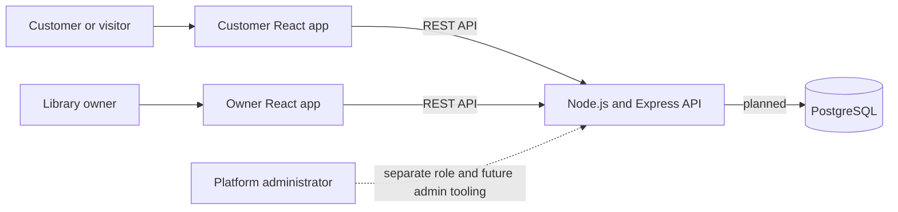
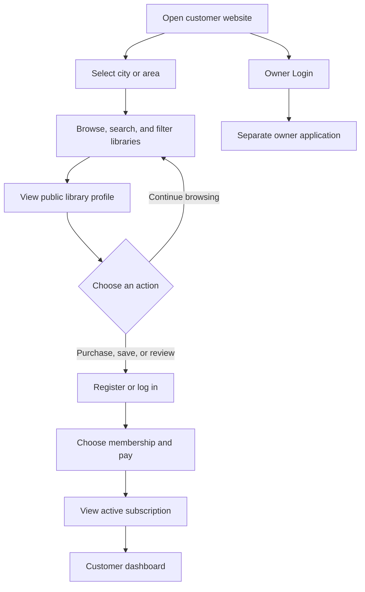
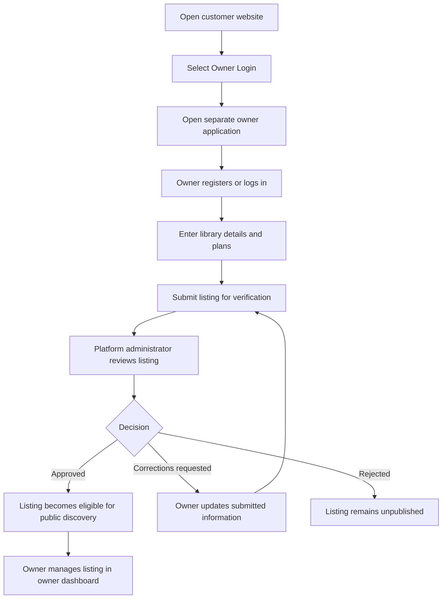
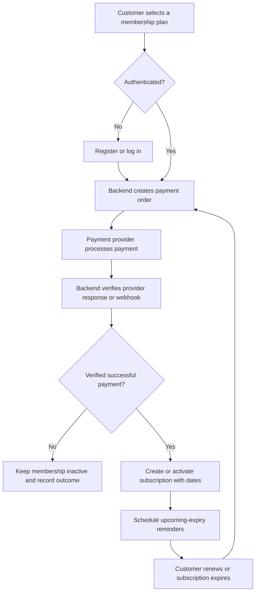
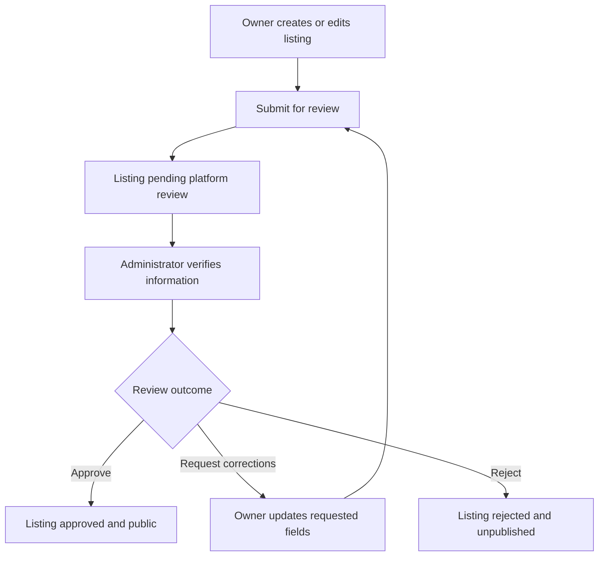

# Library Platform

A location-first discovery and membership platform that connects students and other customers with study libraries and their owners. Customers can explore public listings; library owners will use a separate application to publish and manage their listings. Both applications are designed to use one shared API.

This is **not** a library inventory, book lending, or book issuing system. The current repository establishes the application structure and a small API foundation. Most product capabilities described below are planned and are not implemented yet.

## Problem statement

Finding a suitable study library often means searching scattered listings or visiting locations to compare prices, facilities, hours, and seat availability. Library owners also need a focused way to present their spaces and memberships to prospective members. This platform is intended to bring discovery and owner listing workflows together while keeping customer, owner, and administrator responsibilities distinct.

## Project objectives

- Let visitors discover study libraries by city, locality, and area without requiring an account.
- Give customers a dedicated experience for memberships, subscriptions, saved libraries, reviews, and account details.
- Give owners a separate application for onboarding and managing their library listings.
- Use one backend API as the shared source of truth for both applications.
- Keep platform administrator permissions separate from library-owner permissions.
- Build a maintainable foundation without implementing product workflows prematurely.

## How the platform works

The public customer application is the main entry point. A visitor chooses a location, browses and compares public library listings, and can view a library profile without signing in. Account access is intended only when the visitor wants to take an account-specific action, such as purchasing a membership, saving a library, or writing a review.

The customer website provides an **Owner Login** link to the distinct owner application. Owners will register or sign in there, submit library details for review, and manage their own listings after approval. Platform administrators review listings and supervise platform activity through administrator capabilities; a third administrator frontend is outside the current scope.

## Application architecture

There are two independent React applications and one shared Node.js/Express REST API:

- **Customer web** (`apps/customer-web/`): public discovery and future customer account journeys.
- **Owner web** (`apps/owner-web/`): separate owner entry point and future listing management workflows.
- **Backend** (`backend/`): shared API boundary. Currently it exposes only a health endpoint.
- **Database**: PostgreSQL is the intended relational database. No database package, schema, connection, or integration is configured yet.

The separate frontends allow each user group to have its own navigation, pages, and eventual access controls. This separation alone is not authorization: the backend must enforce role-based permissions when account features are implemented. The platform administrator remains a separate role and is not granted owner permissions by default.



## Customer application

The customer application is public-facing and serves as the main discovery entry point. Its planned capabilities include:

- **Location and discovery:** choose a city, locality, or area; search by library name or location; browse nearby listings; filter by price, facilities, hours, ratings, and seat availability; sort and compare results.
- **Library profiles:** show descriptions, addresses, map directions, photos, amenities, opening hours, rules, membership plans and prices, seating capacity, availability, ratings, and reviews.
- **Authentication and account:** customer registration, login, logout, profile, account dashboard, and saved or favourited libraries.
- **Memberships and subscriptions:** view plans, purchase a membership, view active and past subscriptions, see start and expiry dates, renew, review payment history, and receive upcoming-expiry reminders.
- **Reviews:** rate a library, write and view reviews, and report inappropriate content.

The customer app presents Kitaab as the location-first entry point with Home, Locations, Events, and About pages, a responsive navigation/footer, an editorial photo hero, and textured discovery sections. The location search and listing cards are a local sample prototype. The sample data and displayed availability are static prototype content; search is not connected to the API and availability is not live.

## Library-owner application

The owner application is a separate React application with its own URL, package manifest, and experience. Owners will not manage libraries inside the customer dashboard. Planned capabilities include:

- Owner registration, login, logout, profile, and dashboard.
- Library onboarding with name, description, address, location, photos, facilities, hours, rules, capacity, and membership plans.
- Submission for verification, visibility controls, approval status, and correction requests.
- Listing edits, photo and amenity updates, operating hours, rules, and pricing changes.
- Manual seat and occupancy updates.
- Views of members, active memberships, expiry dates, membership history, and payment records.
- Reviews, ratings, listing performance, membership and occupancy statistics, and upcoming renewals.

The current owner app is a minimal shell that makes the application independently runnable. Registration, onboarding, dashboards, and management actions are not implemented.

## Platform administrator responsibilities

Platform administrators are distinct from library owners. Planned responsibilities include approving, rejecting, or requesting corrections for listings; verifying submitted information; managing customer and owner accounts; suspending inappropriate accounts or listings; moderating reviews and reports; monitoring transactions; viewing platform-wide statistics; and maintaining an audit trail. No administrator frontend or admin workflows are implemented in this task.

## Customer journey

Public browsing and profiles are intended to work without authentication. Authentication is expected for membership purchase, subscription management, favourites, and reviews.



## Owner journey



## Subscription and payment lifecycle

The intended lifecycle uses a backend-created payment order and backend verification. A frontend success screen alone must never activate a membership. Payment provider webhooks should be processed idempotently so duplicate delivery cannot create duplicate activations. These steps are architecture plans only; there is no payment integration or subscription implementation in this repository yet.



## Library verification and approval workflow

A listing should not appear as approved or publicly discoverable until platform review is complete. Admin decisions and owner corrections should be recorded for traceability when this workflow is implemented.



## Seat availability workflow

At first, owners are expected to update capacity and available or occupied seats manually. The API should validate that counts are non-negative and consistent with total capacity. Automated check-in or real-time occupancy is not part of the current implementation.

## High-level technical architecture

Both frontends will call the same REST API using their respective `VITE_API_BASE_URL` setting. The backend will own authentication and authorization, listing approval, subscription records, payment verification, and other authoritative business rules. PostgreSQL is the intended relational store, but is not connected or configured. Payment gateway, image storage, email/notification delivery, and maps/geolocation are planned integrations for later work.

## Technology stack

| Area | Current foundation / direction |
| --- | --- |
| Customer frontend | React, Vite, JavaScript, React Router |
| Owner frontend | React, Vite, JavaScript, React Router dependency included |
| Backend | Node.js, Express.js, REST API |
| Database | PostgreSQL intended; not configured |
| Future integrations | India-suitable payment gateway, image storage, email/notifications, maps/geolocation; not implemented |

There is no AI, RAG, chatbot, vector database, or AI-specific architecture in this project.

## Repository structure

```text
library-platform/
├── apps/
│   ├── customer-web/
│   │   ├── public/
│   │   ├── src/
│   │   │   ├── assets/
│   │   │   ├── components/{common,layout,library}/
│   │   │   ├── features/{authentication,discovery,location,reviews,subscriptions}/
│   │   │   ├── hooks/
│   │   │   ├── pages/{authentication,public}/
│   │   │   ├── services/
│   │   │   ├── styles/
│   │   │   ├── App.jsx
│   │   │   └── main.jsx
│   │   ├── .env.example
│   │   ├── package.json / package-lock.json
│   │   └── vite.config.js
│   └── owner-web/
│       ├── public/
│       ├── src/{assets,components,features,hooks,pages,services,styles}/
│       ├── .env.example
│       ├── package.json / package-lock.json
│       └── vite.config.js
├── backend/
│   ├── src/{config,middleware,modules,routes,utils}/
│   │   ├── app.js
│   │   └── server.js
│   ├── tests/
│   ├── .env.example
│   └── package.json / package-lock.json
├── .gitignore
└── README.md
```

`components/` holds reusable UI, `features/` groups feature-specific code, `pages/` maps route-level views, and `services/` is the future API integration boundary. Backend `modules/` groups domain capabilities; `routes/` will connect HTTP endpoints to module logic; `middleware/`, `config/`, and `utils/` hold cross-cutting concerns. Empty folders are retained with `.gitkeep` until real code is added. The two frontend packages remain independent; no root package manager, Nx, or Turborepo is introduced.

## Planned backend modules

The module directories mark future areas only: `auth`, `users`, `owners`, `libraries`, `subscriptions`, `payments`, `reviews`, and `notifications`. No controllers, domain services, database models, or feature endpoints have been added. The current backend contains the Express app/server and `GET /api/health` only.

## Planned database entities and relationships

These are conceptual entities, not an implemented schema:

- **User** has a customer or owner role and may have a related owner profile.
- **Owner** can manage one or more **Library** listings.
- **Library** has location, facilities, hours, capacity, approval status, and one or more **MembershipPlan** records.
- **Customer** can have **Subscription** records for a library plan; a subscription has related **Payment** records.
- **Customer** can create **Review** records for libraries; **ReviewReport** records support moderation.
- **Notification** records or delivery events can reference a user and a subscription or moderation event.
- **AdminAction** records preserve an audit trail for administrative decisions.

Foreign keys, uniqueness rules, lifecycle constraints, and privacy requirements will be defined when the database design is implemented.

## Planned API areas

Only `GET /api/health` exists today. Future REST API areas may include:

- Public library discovery, filters, location lookup, and library profiles.
- Customer and owner authentication, profiles, and role-aware account access.
- Owner library onboarding, listing management, seat availability, and member views.
- Administrator listing review, account management, moderation, and audit actions.
- Membership plans, subscription history, renewals, payment order creation, and payment verification/webhooks.
- Reviews, review reports, notifications, and analytics.

## Local development setup

Requirements: Node.js and npm compatible with the installed Vite version. Each application and the backend has its own dependencies and lockfile; run package commands from that package directory. No root-level scripts are defined.

1. Clone the repository and enter it:

   ```bash
   git clone https://github.com/ankit-70177/library-platform.git
   cd library-platform
   ```

2. Install each package separately:

   ```bash
   cd apps/customer-web && npm ci
   cd ../owner-web && npm ci
   cd ../../backend && npm ci
   ```

   Alternatively, return to the repository root between each directory to avoid ambiguity.

3. Copy the relevant `.env.example` file to `.env` in each package if you need to change the local defaults. The current health endpoint only reads `PORT`; the frontends do not yet call the API.

### Run the customer frontend

```bash
cd apps/customer-web
cp .env.example .env
npm run dev
```

Vite prints the local URL (normally `http://localhost:5173`). `VITE_OWNER_APP_URL` points to the owner frontend and defaults to `http://localhost:5174`.

### Run the owner frontend

```bash
cd apps/owner-web
cp .env.example .env
npm run dev
```

The owner app uses port `5174` by default. `VITE_CUSTOMER_APP_URL` points back to the customer website.

### Run the backend

```bash
cd backend
cp .env.example .env
npm run dev
```

The API listens on port `5001` by default. Use `npm start` to run without watch mode. The current health endpoint is `GET http://localhost:5001/api/health`.

## Environment variables

| Package | Variable | Purpose | Current use |
| --- | --- | --- | --- |
| Customer | `VITE_API_BASE_URL` | Shared backend API base URL | Reserved; no API service calls yet |
| Customer | `VITE_OWNER_APP_URL` | Owner app entry point | Used by the Owner Login link |
| Owner | `VITE_API_BASE_URL` | Shared backend API base URL | Reserved; no API service calls yet |
| Owner | `VITE_CUSTOMER_APP_URL` | Customer site URL | Used by the customer site link |
| Backend | `PORT` | HTTP server port | Used; defaults to `5001` |

Never commit real `.env` files, credentials, or secrets. `.env.example` files contain non-secret local defaults.

## Current implementation status

- **Implemented:** existing customer-facing prototype relocated under `apps/customer-web/`; its home page, sample library cards, navigation, footer, and styles remain. The Home, Locations, Events, and About pages provide the initial branded public experience. Public routes include Home, Locations, Events, and About. A separate owner React/Vite app shell exists. The Express server exposes `GET /api/health`.
- **Structure prepared:** independent customer and owner applications, feature-oriented frontend folders, backend module folders, environment examples, and per-package scripts/lockfiles.
- **Planned, not implemented:** real location selection/search, API-backed listings, authentication and authorization, owner onboarding and dashboard, platform approval, PostgreSQL integration, seat management, memberships, payment processing, reviews, notifications, analytics, maps, image storage, and admin tooling.

The home page currently uses hardcoded sample library values. Any sample occupancy is static and must not be interpreted as real-time availability. No login or signup flow is working. No PostgreSQL connection is present.

## Future development roadmap

1. Agree the initial domain model, roles, authorization rules, and API conventions.
2. Configure PostgreSQL and migrations after reviewing the data model.
3. Implement API-backed public library discovery and location filters.
4. Add customer and owner authentication with backend-enforced role permissions.
5. Build owner onboarding and administrator listing approval workflow.
6. Add membership plans, verified payments, subscriptions, and renewal lifecycle.
7. Add reviews, moderation, owner seat updates, and notification delivery.
8. Add maps, image storage, reporting, and operational analytics.

## Team development and Git workflow

- Start from the repository's default branch and create a focused feature branch.
- Keep customer and owner changes in their respective app folders; both integrate with the shared backend API.
- Use small, descriptive commits that reflect actual changes. Do not rewrite history, fabricate contributions, or force-push.
- Open pull requests against the default branch, describe scope and verification, and request the repository's normal review.
- Keep dependencies in their owning package. Do not commit `node_modules/`, build output, `.env` files, credentials, or secrets.
- Run relevant package build commands before submitting changes and report any checks that could not be run.
