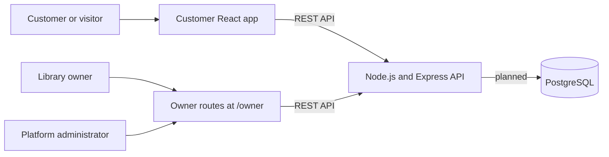
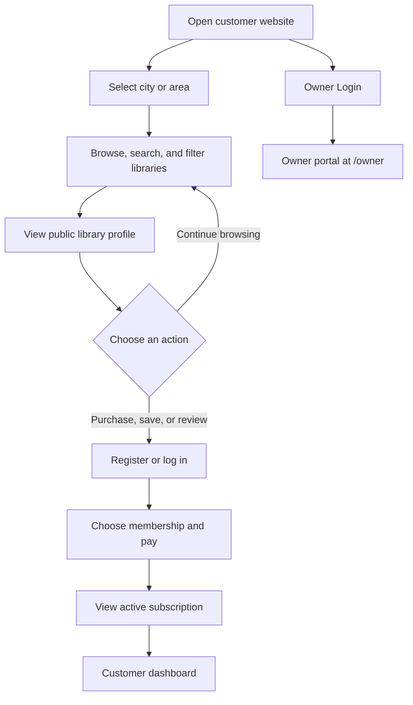
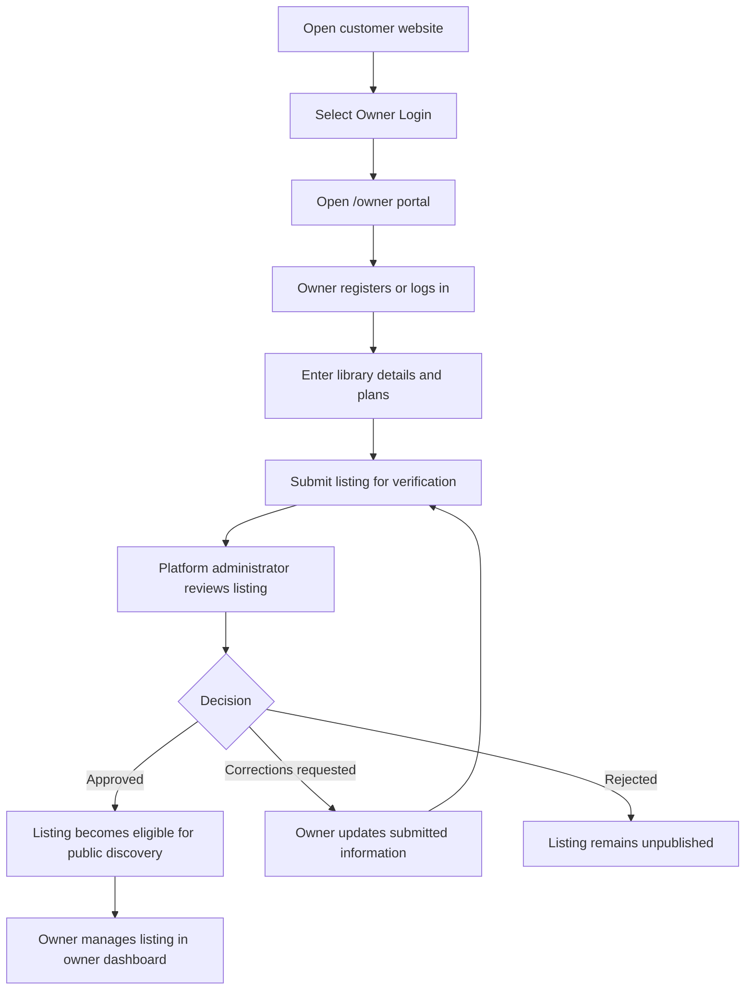
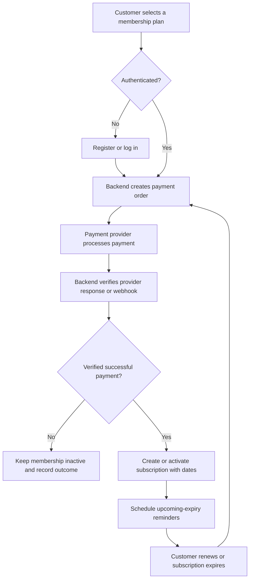
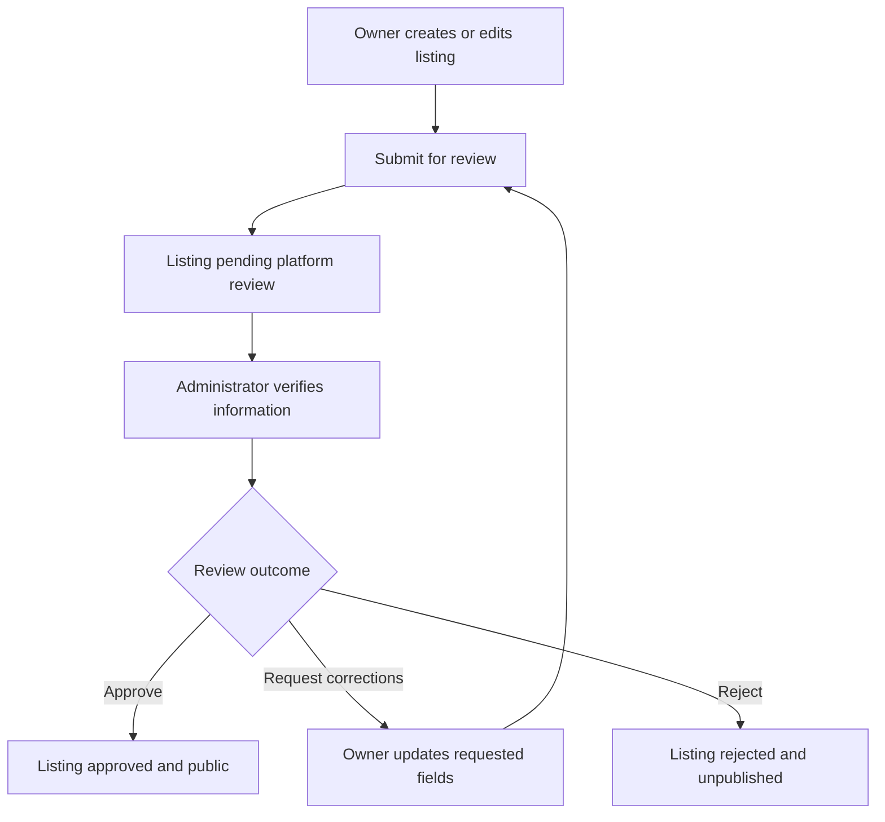

# Library Platform

A location-first discovery and membership platform that connects students and other customers with study libraries and their owners. Customers can explore public listings and owners can manage their listings in role-specific routes in one web application. Both experiences use one shared API.

This is **not** a library inventory, book lending, or book issuing system. The repository includes customer and owner/admin experiences, a shared API, and a PostgreSQL schema. Some product capabilities are implemented while others remain planned or partial.

## Problem statement

Finding a suitable study library often means searching scattered listings or visiting locations to compare prices, facilities, hours, and seat availability. Library owners also need a focused way to present their spaces and memberships to prospective members. This platform is intended to bring discovery and owner listing workflows together while keeping customer, owner, and administrator responsibilities distinct.

## Project objectives

- Let visitors discover study libraries by city, locality, and area without requiring an account.
- Give customers a dedicated experience for memberships, subscriptions, saved libraries, reviews, and account details.
- Give owners a dedicated route group for onboarding and managing their library listings.
- Use one backend API as the shared source of truth for customer and owner workflows.
- Keep platform administrator permissions separate from library-owner permissions.
- Build a maintainable foundation without implementing product workflows prematurely.

## How the platform works

The public customer application is the main entry point. A visitor chooses a location, browses and compares public library listings, and can view a library profile without signing in. Account access is intended only when the visitor wants to take an account-specific action, such as purchasing a membership, saving a library, or writing a review.

The customer website provides an **Owner Login** link to `/owner/login`. Owners register or sign in there, submit library details for review, and manage their own listings after approval. Platform administrators use the administrator workspace at `/owner/dashboard`.

## Application architecture

There is one React application with separate role-based route groups and one shared Node.js/Express REST API:

- **Web app** (`apps/customer-web/`): public discovery and customer account journeys, plus the owner and administrator portal under `/owner/*`.
- **Backend** (`backend/`): shared Node.js/Express API for customer, owner, and administrator workflows.
- **Database**: PostgreSQL schema, connection configuration, and migrations are present.

The route groups give each user group its own pages and navigation while sharing the frontend runtime and API client. This separation alone is not authorization: the backend enforces role-based permissions for protected data and actions. The platform administrator remains a separate role and is not granted owner permissions by default.



## Customer application

The customer application is public-facing and serves as the main discovery entry point. Its planned capabilities include:

- **Location and discovery:** choose a city, locality, or area; search by library name or location; browse nearby listings; filter by price, facilities, hours, ratings, and seat availability; sort and compare results.
- **Library profiles:** show descriptions, addresses, map directions, photos, amenities, opening hours, rules, membership plans and prices, seating capacity, availability, ratings, and reviews.
- **Authentication and account:** customer registration, login, logout, profile, account dashboard, and saved or favourited libraries.
- **Memberships and subscriptions:** view plans, purchase a membership, view active and past subscriptions, see start and expiry dates, renew, review payment history, and receive upcoming-expiry reminders.
- **Reviews:** rate a library, write and view reviews, and report inappropriate content.

The customer app presents Kitaab as the location-first entry point with Home, Locations, Events, and About pages, a responsive navigation/footer, an editorial photo hero, and textured discovery sections. The location search and listing cards are a local sample prototype. The sample data and displayed availability are static prototype content; search is not connected to the API and availability is not live.

## Owner portal

The owner portal has its own route group and experience inside the shared React application. Owners will not manage libraries inside the customer dashboard. Planned capabilities include:

- Owner registration, login, logout, profile, and dashboard.
- Library onboarding with name, description, address, location, photos, facilities, hours, rules, capacity, and membership plans.
- Submission for verification, visibility controls, approval status, and correction requests.
- Listing edits, photo and amenity updates, operating hours, rules, and pricing changes.
- Manual seat and occupancy updates.
- Views of members, active memberships, expiry dates, membership history, and payment records.
- Reviews, ratings, listing performance, membership and occupancy statistics, and upcoming renewals.

The owner routes provide sign-in and owner-application flows, plus owner and administrator dashboards. Some product workflows remain incomplete.

## Platform administrator responsibilities

Platform administrators are distinct from library owners. Planned responsibilities include approving, rejecting, or requesting corrections for listings; verifying submitted information; managing customer and owner accounts; suspending inappropriate accounts or listings; moderating reviews and reports; monitoring transactions; viewing platform-wide statistics; and maintaining an audit trail. An initial admin dashboard and listing/application review flows are in the owner portal route group.

## Customer journey

Public browsing and profiles are intended to work without authentication. Authentication is expected for membership purchase, subscription management, favourites, and reviews.



## Owner journey



## Subscription and payment lifecycle

The intended lifecycle uses a backend-created payment order and backend verification. A frontend success screen alone must never activate a membership. Payment provider webhooks should be processed idempotently so duplicate delivery cannot create duplicate activations. These steps are architecture plans only; there is no payment integration or subscription implementation in this repository yet.



## Library verification and approval workflow

A listing should not appear as approved or publicly discoverable until platform review is complete. Admin decisions and owner corrections should be recorded for traceability when this workflow is implemented.



## Seat availability workflow

At first, owners are expected to update capacity and available or occupied seats manually. The API should validate that counts are non-negative and consistent with total capacity. Automated check-in or real-time occupancy is not part of the current implementation.

## High-level technical architecture

The web application calls one REST API using `VITE_API_BASE_URL`. The backend owns authentication and authorization, listing approval, subscription records, payment verification, and other authoritative business rules. PostgreSQL is the relational store for the local setup. Payment gateway, image storage, email/notification delivery, and maps/geolocation are planned integrations for later work.

## Technology stack

| Area | Current foundation / direction |
| --- | --- |
| Web frontend | React, Vite, JavaScript, React Router; customer and owner route groups |
| Backend | Node.js, Express.js, REST API |
| Database | PostgreSQL |
| Future integrations | India-suitable payment gateway, image storage, email/notifications, maps/geolocation; not implemented |

There is no AI, RAG, chatbot, vector database, or AI-specific architecture in this project.

## Repository structure

```text
library-platform/
├── apps/
│   ├── customer-web/
│   │   ├── public/
│   │   ├── src/
│   │   │   ├── assets/
│   │   │   ├── components/{layout,owner}/
│   │   │   ├── pages/{customer,owner,public}/
│   │   │   ├── services/
│   │   │   ├── styles/
│   │   │   ├── App.jsx
│   │   │   └── main.jsx
│   │   ├── .env.example
│   │   ├── package.json / package-lock.json
│   │   └── vite.config.js
├── backend/
│   ├── src/{config,middleware,modules,routes,utils}/
│   │   ├── app.js
│   │   └── server.js
│   ├── tests/
│   ├── .env.example
│   └── package.json / package-lock.json
├── .gitignore
└── README.md
```

`components/` holds reusable UI, `pages/` maps route-level views, and `services/` contains the shared API client. Backend `modules/` groups domain capabilities; `routes/` connect HTTP endpoints to module logic; `middleware/`, `config/`, and `utils/` hold cross-cutting concerns. Customer and owner pages share one frontend package; the API remains an independent backend service.

## Planned backend modules

Backend modules cover authentication, owner workflows, libraries, discovery, subscriptions, bookings, payments, reviews, and dashboards. The route groups are registered under `/api`; the health endpoint reports API and database availability.

## Planned database entities and relationships

These are conceptual entities, not an implemented schema:

- **User** has a customer or owner role and may have a related owner profile.
- **Owner** can manage one or more **Library** listings.
- **Library** has location, facilities, hours, capacity, approval status, and one or more **MembershipPlan** records.
- **Customer** can have **Subscription** records for a library plan; a subscription has related **Payment** records.
- **Customer** can create **Review** records for libraries; **ReviewReport** records support moderation.
- **Notification** records or delivery events can reference a user and a subscription or moderation event.
- **AdminAction** records preserve an audit trail for administrative decisions.

Foreign keys, uniqueness rules, lifecycle constraints, and privacy requirements will be defined when the database design is implemented.

## Planned API areas

The API currently includes:

- Public library discovery, filters, location lookup, and library profiles.
- Customer and owner authentication, profiles, and role-aware account access.
- Owner library onboarding, listing management, seat availability, and member views.
- Administrator listing review, account management, moderation, and audit actions.
- Membership plans, subscription history, renewals, payment order creation, and payment verification/webhooks.
- Reviews, review reports, notifications, and analytics.

## Local development setup

Requirements: Node.js and npm compatible with the installed Vite version. The web app and backend each have their own dependencies and lockfile; run package commands from that package directory. No root-level scripts are defined.

1. Clone the repository and enter it:

   ```bash
   git clone https://github.com/ankit-70177/library-platform.git
   cd library-platform
   ```

2. Install the web app and backend dependencies:

   ```bash
   cd apps/customer-web && npm ci
   cd ../../backend && npm ci
   ```

   Alternatively, return to the repository root between each directory to avoid ambiguity.

3. Copy the relevant `.env.example` file to `.env` and set the database connection and authentication secret for your local environment.

   For local login, set `JWT_SECRET` in `backend/.env` to a private random value. After applying the database schema and migrations, run `cd backend && npm run seed:demo` to create the demo customer, owner, and admin accounts shown on the login screens. The demo seed script refuses to run when `NODE_ENV=production`.

### Run the web app

```bash
cd apps/customer-web
cp .env.example .env
npm run dev
```

Vite serves customer routes and owner routes at `http://localhost:5173`. Open `/owner/login`, `/owner/apply`, or `/owner/dashboard` for the owner portal. Requests to `/api` are proxied to the backend on port `5001`, so the browser uses one origin during development.

### Run the backend

```bash
cd backend
cp .env.example .env
npm run dev
```

The API listens on port `5001` by default. Use `npm start` to run without watch mode. The current health endpoint is `GET http://localhost:5001/api/health`.

For production, serve the built web app on the public domain and route `/api/*` to the Express service behind the same domain. Configure the web host to send browser routes such as `/owner/dashboard` to the SPA entry point.

## Environment variables

| Package | Variable | Purpose |
| --- | --- | --- |
| Customer | `VITE_API_BASE_URL` | Backend API base URL |
| Web app | `VITE_API_BASE_URL` | Backend API base URL |
| Backend | `PORT` | HTTP server port; defaults to `5001` |
| Backend | `JWT_SECRET` | Secret used to sign and verify login tokens; required to start the API |
| Backend | `DB_HOST` | PostgreSQL host |
| Backend | `DB_PORT` | PostgreSQL port; defaults to `5432` |
| Backend | `DB_NAME` | PostgreSQL database name |
| Backend | `DB_USER` | PostgreSQL username |
| Backend | `DB_PASSWORD` | PostgreSQL password; optional in the current connection configuration |

Copy each package's `.env.example` to `.env` and replace database placeholders with your local PostgreSQL settings. Change the example `JWT_SECRET` to a private random value before deployment. Never commit real `.env` files or credentials.

## Current implementation status

- **Customer application:** React/Vite application with public pages, authentication screens, dashboard features, and API service functions.
- **Owner portal:** Owner sign-in/application and owner/admin dashboards under `/owner/*` in the shared React/Vite application.
- **Backend:** Express application with registered route groups for authentication, owners, libraries, saved libraries, discovery, subscriptions, bookings, payments, reviews, customer dashboard, owner dashboard, and admin dashboard.
- **Database:** PostgreSQL connection configuration, schema definition, and six numbered SQL migration files are present.
- **Health check:** `GET /api/health` is registered.

The presence of routes, controllers, frontend screens, or migration files does not by itself confirm that every end-to-end workflow has been tested. A reachable PostgreSQL database and valid environment settings are required to run the database-dependent backend.

## Future development roadmap

1. Agree the initial domain model, roles, authorization rules, and API conventions.
2. Configure PostgreSQL and migrations after reviewing the data model.
3. Implement API-backed public library discovery and location filters.
4. Add customer and owner authentication with backend-enforced role permissions.
5. Build owner onboarding and administrator listing approval workflow.
6. Add membership plans, verified payments, subscriptions, and renewal lifecycle.
7. Add reviews, moderation, owner seat updates, and notification delivery.
8. Add maps, image storage, reporting, and operational analytics.

## Team development and Git workflow

- Start from the repository's default branch and create a focused feature branch.
- Keep customer and owner changes in their respective app folders; both integrate with the shared backend API.
- Use small, descriptive commits that reflect actual changes. Do not rewrite history, fabricate contributions, or force-push.
- Open pull requests against the default branch, describe scope and verification, and request the repository's normal review.
- Keep dependencies in their owning package. Do not commit `node_modules/`, build output, `.env` files, credentials, or secrets.
- Run relevant package build commands before submitting changes and report any checks that could not be run.

## Backend implementation details

The backend uses Express and PostgreSQL. Route groups are registered under `/api`, including authentication, owner applications, library management and discovery, saved libraries, subscriptions, bookings, payments, reviews, and customer, owner, and administrator dashboards.

Database-related files are located under `backend/src/config/`, including `schema.sql` and numbered SQL migrations. The database connection is configured through the environment variables listed above.

The backend startup process checks the PostgreSQL connection before listening for HTTP requests. Configure a reachable database before starting the server.
